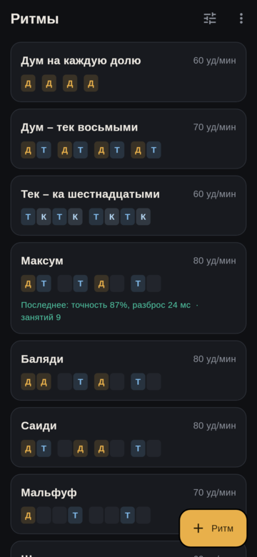
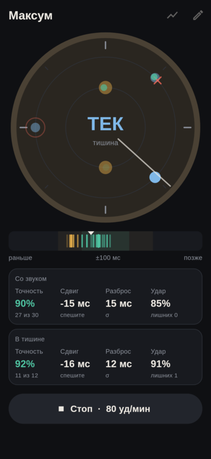
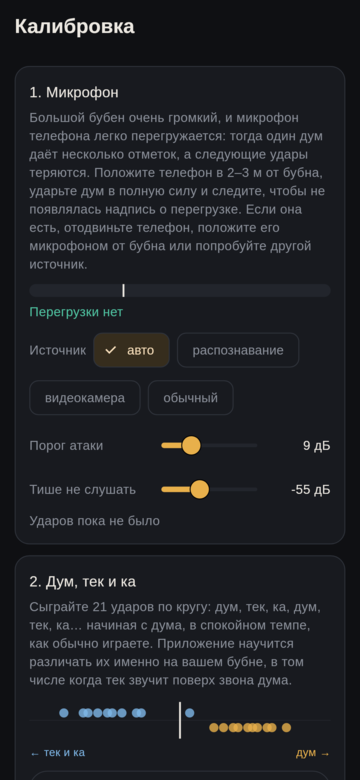

# Frame Drum

An Android app for practising rhythms on a large frame drum (made for a
40 cm one). You pick or write a pattern of strokes: **dum** (the open bass
in the centre of the head), **tek** and **ka** (rim strokes of the strong and
the weak hand). The app plays a metronome, shows which stroke comes next,
listens to the drum through the phone's microphone and tells you how close
to the beat each stroke landed and whether it was the right one.

The user interface is in Russian.

<p>
  
  
  
</p>

## Features

- Built-in rhythms (maqsum, baladi, saidi, malfuf, 6/8) and warm-up
  exercises; your own patterns in quarters, eighths, triplets or sixteenths,
  edited by tapping cells or typed as `DT-T D-T-`.
- Metronome on every beat, only at the start of the cycle, or off, with a
  count-in. Clicks can follow uneven groups such as `3+3+2` (used for
  malfuf).
- Silent-cycle training: e.g. two cycles with the metronome, two without, to
  check that you keep the tempo yourself. Results with and without sound are
  shown separately.
- Optional guide: the phone plays the pattern itself (dum and tek sounds).
- Live feedback on a dial drawn like the drum head: strokes appear where
  they actually landed, coloured by timing, with wrong strokes, misses and
  extra hits marked. A strip below shows the last timing errors on a
  ±100 ms scale.
- Per session: accuracy (share of strokes within ±50 ms), mean offset
  (rushing or dragging), spread (standard deviation of the offset, the main
  measure of evenness) and the share of correctly recognised strokes.
  History per rhythm with a progress chart.
- Dum versus rim strokes are told apart by a small model trained on your
  own drum in calibration and, optionally, refined from your practice
  sessions.

## Using it

1. **Calibrate** (the sliders icon on the home screen), once per phone and
   drum:
   - *Microphone.* Put the phone 2–3 m from the drum and play a full dum. A
     big frame drum easily overloads a phone microphone: if the app reports
     overload, move the phone away, turn its microphone away from the drum
     or try another input source. Each stroke should give exactly one mark;
     adjust the attack threshold if strokes are lost or doubled.
   - *Strokes.* Play 21 strokes round and round: dum, tek, ka, dum, tek, ka…
     starting with dum, the way you normally play. The app learns how they
     sound on your drum and shows how well it can tell them apart.
   - *Latency.* Through the speaker, the phone plays clicks and listens to
     them itself (keep quiet for about 10 seconds). With headphones, play a
     dum on each of 16 clicks instead. The correction is kept separately for
     the speaker, wired and Bluetooth headphones. This test also measures how
     loud the click is at the microphone and turns it down if it would drown
     strokes played on it.
2. **Pick a rhythm** or create one with the "+" button.
3. **Practise**: set the tempo, metronome mode, silent cycles and guide,
   then press Start. After Stop the session is saved to the history.

Headphones work best: the microphone then hears only the drum. Through the
speaker the app filters out its own clicks (a high 7/8.5 kHz click that the
detector notches out), but a click loud enough to overload the microphone
still hides a stroke played exactly on it. The guide sounds are much harder
to separate from real strokes, so use the guide with headphones.

## Building

The easiest way is Nix (flakes), which provides Flutter, JDK 17 and the
Android SDK and NDK:

```sh
nix run .#build-apk   # build/app/outputs/flutter-apk/app-arm64-v8a-release.apk
nix run .#install     # build and install on a phone over adb (USB debugging on)
nix develop           # a shell with flutter, the JDK and the Android SDK
```

The first run downloads about 1.5 GB. Gradle keeps its own dependencies in
`~/.gradle`, so the build is not a pure Nix derivation.

Without Nix you need Flutter 3.47 (Dart 3.13), JDK 17 and an Android SDK
with platform 36, build tools 36.0.0 and NDK 28.2.13676358; then the usual
`flutter build apk --release` works. The app needs Android 8.0 (API 26) or
newer. There are no Flutter plugins: audio, storage and permissions go
through the app's own platform channels.

Tests and screenshots:

```sh
nix develop -c flutter test        # detector, classifier, scoring, gate
# render the screens to test_screens/out/ without a phone
nix develop -c sh -c 'SCREEN_FONT_DIR=$(nix build --no-link --print-out-paths nixpkgs#liberation_ttf)/share/fonts/truetype \
  SCREEN_ICON_FONT=$(dirname $(dirname $(readlink -f $(which flutter))))/bin/cache/artifacts/material_fonts/MaterialIcons-Regular.otf \
  flutter test test_screens --update-goldens'
```

## How it works

- `android/.../AudioEngine.kt` only moves samples. An `AudioTrack` loops a
  pre-rendered buffer (count-in, then the pattern), an `AudioRecord`
  (`UNPROCESSED` source when available, otherwise `VOICE_RECOGNITION`, to
  avoid automatic gain control) delivers 10 ms chunks. Both are tied to
  `System.nanoTime()` through `getTimestamp()`, so click times and stroke
  times can be compared directly; buffer latency doesn't matter.
- `lib/audio.dart` smooths those timestamps: the playback clock tells
  timestamp jitter from real dropouts, and the microphone clock follows the
  sample counter, since per-chunk timestamps jitter by up to 10 ms.
- `lib/dsp.dart` is the onset detector. A large drum rings for a long time
  and its modes beat, so loudness alone gives false and late onsets. The
  signal is split into eight octave bands; an attack is a rise across bands,
  weighted to the upper ones and required above 1.4 kHz. The threshold
  adapts to how hard you play and to microphone clipping, a refractory
  period depends on the pattern, and a much louder attack right after an
  onset replaces it (fingers touching the skin before the palm). Stroke
  features are the per-band level rise over the 20 ms before the attack (so
  the ringing of the previous dum doesn't count) and the spectral shape
  after it. `StrokeModel` holds one Gaussian centre per stroke type with a
  shared variance.
- `lib/gate.dart` drops the app's own sounds heard through the speaker.
- `lib/scoring.dart` matches each onset to the nearest expected stroke
  within a window of half the shortest gap between strokes (40–150 ms).
- `lib/synth.dart` renders the clicks and guide sounds in Dart.
- `test/drum_sim.dart` is a crude model of a 40 cm drum used by the tests.

## Debugging with real recordings

Turn on "Записывать занятия" (record sessions) in calibration. Each session
then leaves `session-*.wav` (the raw microphone signal) and `session-*.json`
(timestamps, settings and what the app detected) on the phone:

```sh
adb pull /sdcard/Android/data/dev.ncrashed.frame_drum/files/ recordings/
# rerun the detector on one recording
nix develop -c dart run tool/replay.dart recordings/session-....wav [attack_threshold_db] [min_level_db]
# score detector variants against the pattern grid
nix develop -c dart run tool/eval.dart recordings/*.wav
nix develop -c dart run tool/eval.dart --cross recordings/*.wav    # leave one session out
nix develop -c dart run tool/eval.dart --online recordings/*.wav   # learning session by session
```
